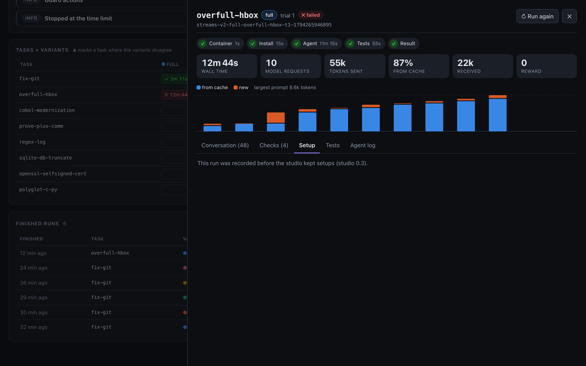

# Amness Evaluation Studio

Run coding-agent benchmarks as **resumable campaigns**, and watch them **live in a browser**: the agent's conversation as it streams, how each variant is doing so far, and buttons to start, pause and resume.

Built for [Amness](https://github.com/amirsdream/Amness) and its harness experiments (switch one guard off, compare), on [Terminal-Bench 2.0](https://www.tbench.ai/) through [Harbor](https://pypi.org/project/harbor/). It works with any agent Harbor can run.


In this page you will learn:

- what a campaign is, and how to run one from the browser or the terminal
- how to install the studio on a server (or a Proxmox container)
- what the UI shows, and how the caches make runs start faster

## What you see

**The run in progress.** Its phases (container, install, agent, tests) with their times, the step, model requests, tokens sent, the share served from the prompt cache, and a bar per model request (cached part and new part). Below, the conversation streams in: the agent's thinking, its messages, each tool call with its full output, file edits as diffs, and the harness's guard actions (nudges, refusals). It updates every second. "Follow" keeps the newest step in view; scroll up to read, and "↓ Latest" brings you back.


**Every finished run.** Click a run (in the progress strip, the task grid or the table) to open it: its phases, tokens, the tests' output, Harbor's error if there was one, and the whole conversation. Each run has its own link (`#run=<job>`). "Run again" sets the result aside and puts the run back in the queue.



**The results so far.**

- **Variants:** the pass rate with a 95% interval (Wilson), the tasks each variant won and lost against the first variant on the same task, timeouts, errors, median tokens and time, and tokens per solved task.
- **Tasks × variants:** one cell per run, coloured by outcome and marked with an icon. ▲ marks a task where the variants disagree.
- **Finished runs:** newest first, with filters by variant and outcome.
- **Up next** and the **runner log** on the side; a toast when a run ends.

Light and dark themes follow your system; the button in the header switches them.

## What a campaign is

A campaign is a file in `campaigns/`: a task list (`subsets/<name>.txt`), a model, the variants to compare, and the number of trials.

```json
{
  "about": "Three guards switched off one at a time.",
  "subset": "mini",
  "model": "custom/qwen-vllm",
  "args": ["--ak", "endpoint=http://my-gpu-box:8000/v1"],
  "trials": 1,
  "variants": {
    "full": [],
    "no-pin": ["--ak", "off=pin"],
    "tool-required": ["--ak", "tool_choice=required"]
  }
}
```

The runs go task by task, with every variant of a task together, so each session adds pairs you can compare. Each finished run is saved at once. Stop anywhere: at most the run in progress is lost, and it runs again next time.

A run where Harbor failed before the agent started (Docker, the image, installing the agent) is not a result about the agent. It is not recorded, and it runs again. Three such failures in a row stop the campaign, so a broken setup does not fill the results with false failures.

## Control it from the browser

The buttons in the header drive the runner inside the studio:

| Button | What it does |
|---|---|
| **▶ Start / Resume** | Runs until the campaign is done. The ▾ menu runs it for 30 minutes, 1 hour or 2 hours instead: a run starts only if it should finish in time. |
| **❚❚ Pause** | Finishes the run in progress, then stops. |
| **■ Stop now** | Interrupts the run in progress. Harbor removes its containers; the run is not recorded and runs again on resume. |
| **↻ Run again** (in a run) | Sets that result aside (kept in `results.removed.jsonl`) and queues the run again. |
| **Warm up the caches only** (▾ menu) | Downloads the tasks and pulls their images, without running anything. |

The controls need the studio's token when `STUDIO_TOKEN` is set (the installer makes one). The browser asks for it once and keeps it. Without a token, anyone who can reach the port can use the controls.

The studio remembers what it was doing. After a restart or a reboot it carries on, or stays paused.

## Faster runs: the caches

A run used to spend about 25 seconds installing Node and the agent in a fresh container, and the first run of each task waited for its image to download. The studio now caches both:

- **The agent's install.** The Harbor adapter installs Node and Amness once on the host into a bundle (`~/.cache/amness-studio/runtime-<hash>.tgz`), rebuilt only when the package changes. Each container unpacks it in a few seconds, with no network. A container where it does not work (no glibc, another CPU) falls back to the old install. Turn it off with `"--ak", "runtime=off"`.
- **The task images.** When a campaign starts, the studio downloads its task files and pulls the images of tasks that have not run yet, in campaign order, while the first run is going. Docker keeps them for later runs.

The progress card shows the warm-up (⛁) and how many task images are ready.

## Run it

You need Node 20.19 or newer, Docker with Compose, and Harbor (`uv tool install harbor`).

```bash
npm install && npm run build                    # build the UI once (and after each update)
node bin/studio.mjs serve --port 8090           # the studio: UI, live stream and runner
```

From the terminal, without the UI:

```bash
node bin/studio.mjs run streams --minutes 30    # a 30-minute session (0 = until done); Ctrl-C once: after this run, twice: now
node bin/studio.mjs status streams              # progress and results so far
node bin/studio.mjs warm streams                # download the tasks and pull their images
```

The terminal runner and the studio do not run the same campaign at once: a lock file in the campaign's data folder prevents it.

Terminal-Bench images are built for x86_64. On an Apple Silicon Mac (or another ARM machine) they run under emulation and are much slower. Run the studio on an x86_64 Linux machine when you can.

## Install on a server

On Debian or Ubuntu (also inside a Proxmox LXC with `nesting=1`), from a checkout of this repository:

```bash
sudo deploy/install-debian.sh
```

It installs Docker with Compose, Node, uv and Harbor, builds the UI, makes the token (`/etc/amness-studio.env`), and starts one service, `amness-studio`, on port 8090. It prints the address and the token.

To update: `git pull && npm ci && npm run build && systemctl restart amness-studio`. The run in progress is interrupted and runs again.

To run Amness from a packed tarball (a server without the Amness repository), put `"--ak", "package=/path/amness.tgz"` in the campaign's `args`. Build it in the Amness repository with `npm run build && npm pack`.

## Develop the UI

The UI is a React app in `ui/`, built with Vite into `ui/dist`, which the server serves.

```bash
STUDIO_URL=http://my-server:8090 npm run dev    # hot reload; /api goes to that studio
npm test                                        # runner, live view, server and controls
```

The API: `GET /api/campaigns`, `/api/campaign/<name>`, `/api/job/<job>?since=<seq>`, `/api/state`, the live stream `/api/stream?campaign=<name>` (Server-Sent Events), and `POST /api/control` with `{"action": "start" | "pause" | "stop" | "resume" | "rerun" | "warm", "campaign", "minutes", "key"}` and the `x-studio-token` header.

## Limits

- One run at a time. A model server with one slot (a llama.cpp default) answers one request at a time anyway.
- With few tasks the intervals are wide: 8 tasks run once can show large effects only. Repeat a difference before believing it.
- The live conversation reads Amness's `--json` events. Other agents show their phases and results, but not each step.
- The token protects the controls, not the pages: anyone who can reach the port can read the runs. Keep the studio on your own network, or behind a reverse proxy with authentication.

## Plans

Comparing two campaigns, reports for sharing, more datasets (SWE-bench through Harbor, Amness's own suites), several runs at once for model servers with more slots, and `amness eval --remote` to submit a campaign from the Amness terminal or desktop app.

## License

MIT
