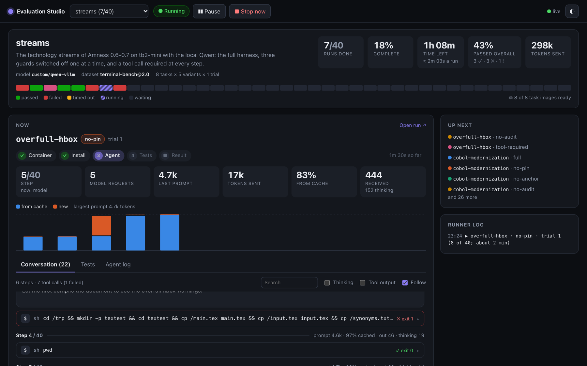
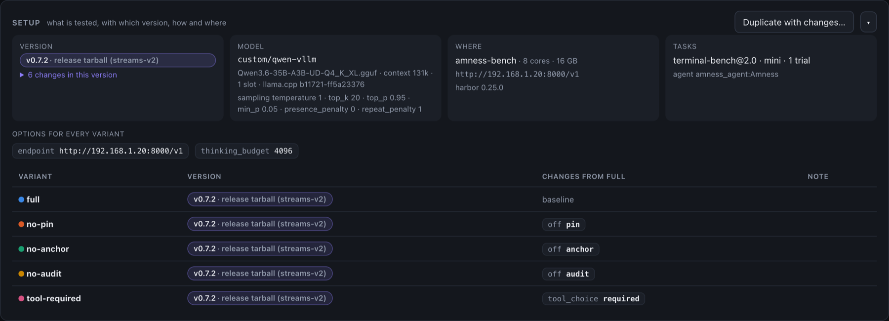
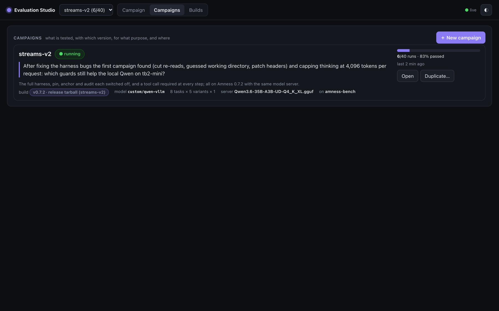
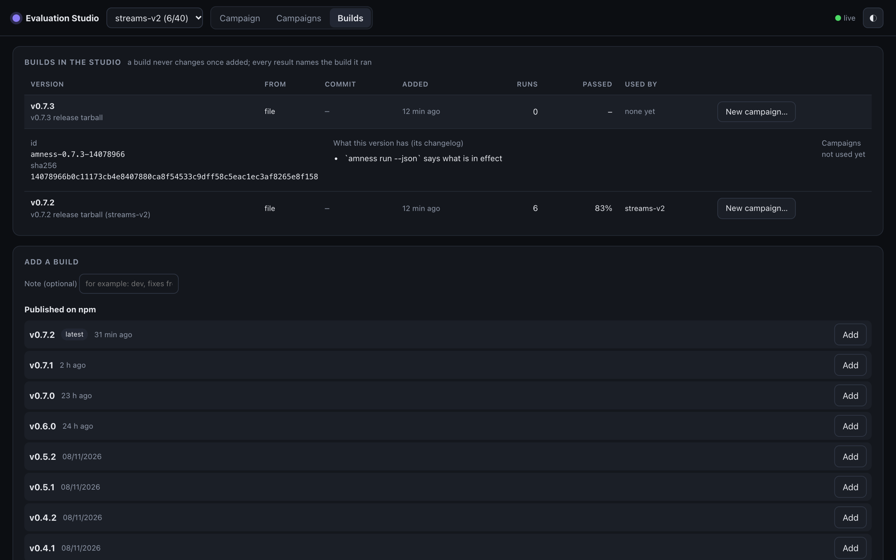
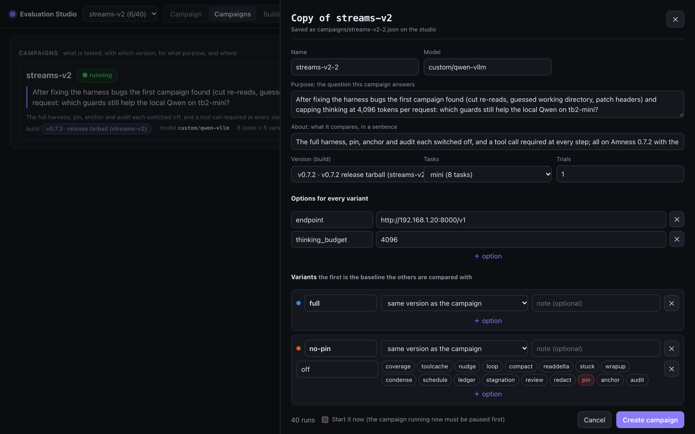
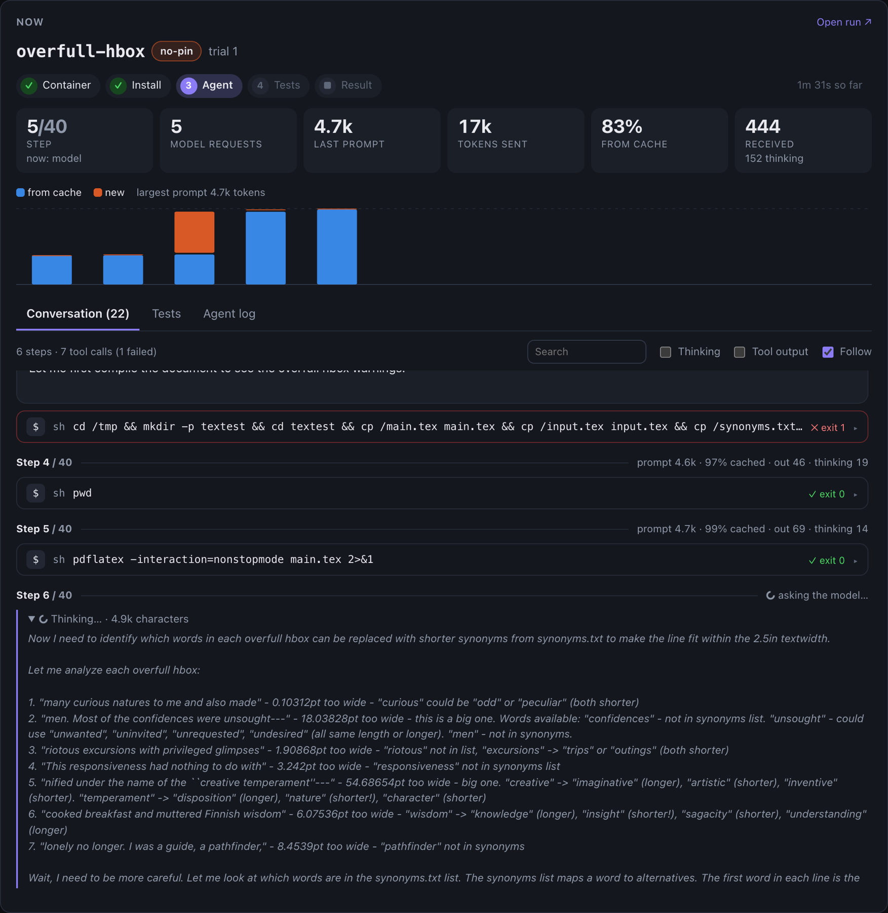
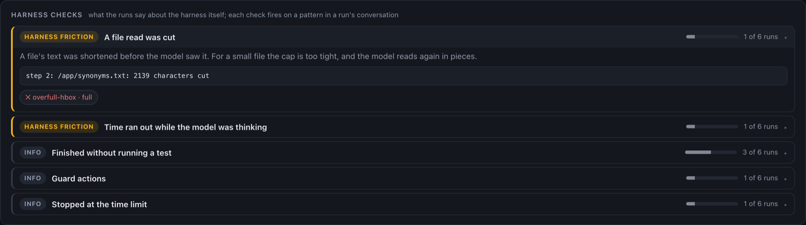

# Amness Evaluation Studio

Run coding-agent benchmarks as **resumable campaigns**, watch them **live in a browser**, and always know **what was tested, with which version, for what purpose, how and where**.

Built for [Amness](https://github.com/amirsdream/Amness) and its harness experiments (switch one guard off, compare two versions), on [Terminal-Bench 2.0](https://www.tbench.ai/) through [Harbor](https://pypi.org/project/harbor/). It works with any agent Harbor can run.



In this page you will learn:

- how a campaign says what it tests, with which version and why, and what each run records
- how to add a version of the agent and start a campaign from the browser, or rerun one with changes
- what the live view and the harness checks show
- how to install the studio on a server

## What, which version, why, how and where

Every campaign and every run answers five questions:

| Question | Where you see it |
|---|---|
| **Why** | The campaign's **purpose**: the question it answers, shown first on its page and in the campaign list. |
| **What** | The tasks (dataset and task list), the model, and the **variants**: each one shown as what it changes from the first (the baseline). |
| **Which version** | The **build**: an agent package that never changes once added, with its version, commit and the changes of that version (from its changelog). Each variant can use its own build, to compare versions. |
| **How** | The options every variant shares, each variant's options, and, for each run, the exact Harbor command and the settings the agent itself reports (guards on and off, limits, thinking budget; Amness 0.7.3 and later). |
| **Where** | The machine (name, cores, memory, Harbor version), the model server as it was set up at that moment (llama.cpp: model file, context, slots, sampling), and the task image with its digest. |



**Campaigns** lists them all with their purpose, version, model, machine, progress and pass rate. **Duplicate…** opens any campaign in the form with all its settings, so a rerun with another version or other options is two clicks.



## Versions of the agent: builds

A build is one agent package, kept unchanged, with a manifest: version, commit, where it came from, checksum, and what that version has (its changelog section). Results point at the build by its id, so replacing a file cannot change what an old result refers to.

Add a build on the **Builds** page:

- **Published on npm:** every version of `amness` is listed (with its tags); **Add** fetches it.
- **From git:** a branch, tag or commit of the Amness repository; the studio checks it out, builds and packs it. Use this for code that is not released yet.
- **A packed file**, on the studio's machine: `node bin/studio.mjs build add path/to/amness.tgz --note "dev"`.

The table shows which campaigns used each build and how they did. **New campaign…** starts the form with that build.



## Start a campaign from the browser

**＋ New campaign** (or **Duplicate…**) opens the form:

1. A name, and the **purpose**: the question this campaign answers.
2. The **version** (a build), the model, the task list and the number of trials.
3. **Options for every variant**, such as `endpoint` (the model server), `thinking_budget`, `max_steps`, `tool_choice`, `request` (extra request fields as JSON). Suggestions appear as you type.
4. The **variants**. The first is the baseline. **＋ One guard off…** adds a variant with that guard switched off; **＋ Another version…** adds one that runs another build with the same settings. A variant's guards are picked from a list.
5. **Create campaign**, optionally starting it at once.

The form writes `campaigns/<name>.json` on the studio's machine. You can also write that file by hand: see `examples/campaign.json`.



## Watch it live

- **Progress:** runs done, time left, pass rate, and a strip with one segment per run (click one to open it).
- **Now:** the run in progress: its phases with their times, the step, model requests, tokens, the share from the prompt cache, a bar per request (cached and new), and the conversation as it streams: thinking, messages, each tool call with its full output, edits as diffs, and the harness's guard actions. "Follow" keeps the newest step in view.
- **Variants:** pass rate with a 95% interval, tasks won and lost against the baseline on the same task, timeouts, median tokens and time.
- **Tasks × variants:** one cell per run; ▲ marks a task where the variants disagree.
- **A run:** its conversation, the harness checks that fired, its recorded **Setup**, the tests' output and the agent's error output. **Run again** queues it again.



## Harness checks: feedback on the agent itself

Every run is read for patterns that point at the harness, not only the model: a guessed working directory, a file read that was cut, a re-read that delivered nothing new, a refused edit batch, a patch that did not apply, very long thinking, time running out mid-request, a finish whose tests then failed, errors on the agent's error output. Each check is marked **bug**, **friction**, **model** or **info**, with the evidence and links to the runs.

`node bin/studio.mjs checks <campaign>` prints the same report in the terminal. The first campaign's checks found three Amness bugs, fixed in 0.7.2.



## Control

| Button | What it does |
|---|---|
| **▶ Start / Resume** | Runs until the campaign is done; the ▾ menu runs it for 30 minutes, 1 hour or 2 hours (a run starts only if it should finish in time). |
| **❚❚ Pause** | Finishes the run in progress, then stops. |
| **■ Stop now** | Interrupts the run in progress; it is not recorded and runs again on resume. |
| **↻ Run again** (in a run) | Sets that result aside (kept in `results.removed.jsonl`) and queues the run again. |

The controls, adding builds and creating campaigns need the studio's token when `STUDIO_TOKEN` is set (the installer makes one); the browser asks for it once. The studio remembers what it was doing, and carries on after a restart.

A run where Harbor failed before the agent started, or that was cancelled, is not a result about the agent: it is not recorded and runs again. Three such failures in a row stop the campaign.

## Faster runs

- **The agent's install:** the Harbor adapter installs Node and Amness once on the host into a cached bundle; each container unpacks it in seconds, with no network (`--ak runtime=off` for the old way).
- **Task images:** when a campaign starts, the studio downloads its tasks and pulls the images that are not here yet, in campaign order.

## Install and run

You need Node 20.19 or newer, Docker with Compose, and Harbor (`uv tool install harbor`).

On Debian or Ubuntu (also a Proxmox LXC with `nesting=1`), from a checkout:

```bash
sudo deploy/install-debian.sh
```

It installs Docker, Node, uv and Harbor, builds the UI, makes the token (`/etc/amness-studio.env`) and starts the `amness-studio` service on port 8090. It prints the address and the token. To update: pause the campaign, then `git pull && npm ci && npm run build && systemctl restart amness-studio`.

Anywhere else:

```bash
npm install && npm run build
node bin/studio.mjs serve --port 8090            # UI, live stream and runner
node bin/studio.mjs build add 0.7.3              # or git:main, or a .tgz
node bin/studio.mjs run <campaign> --minutes 30  # the terminal runner (0 = until done)
node bin/studio.mjs status <campaign>
node bin/studio.mjs checks <campaign>
```

Terminal-Bench images are built for x86_64; on an ARM machine they run under emulation and are much slower.

## Develop

The UI is a React app in `ui/` built with Vite. `STUDIO_URL=http://my-server:8090 npm run dev` serves it with hot reload against a running studio; `npm test` covers the runner, builds, setups, live view, checks and the server.

The API: `GET /api/campaigns`, `/api/campaign/<name>`, `/api/campaign-file/<name>`, `/api/job/<job>`, `/api/builds`, `/api/npm`, `/api/subsets`, `/api/state`, the live stream `/api/stream?campaign=<name>` (Server-Sent Events), and `POST /api/control` with an action (`start`, `pause`, `stop`, `resume`, `rerun`, `warm`, `build-add`, `campaign-create`) and the `x-studio-token` header.

## Limits

- One run at a time. A model server with one slot answers one request at a time anyway.
- With few tasks the intervals are wide: 8 tasks run once can show large effects only. Repeat a difference before believing it.
- The live conversation, the checks and the reported settings read Amness's `--json` events. Other agents show their phases, results and recorded setup.
- The token protects the controls, not the pages. Keep the studio on your own network, or behind a reverse proxy with authentication.

## License

MIT
